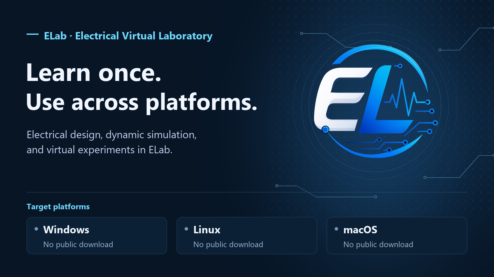

# ELab — Electrical Virtual Laboratory

**ELab 电气虚拟实验室** · [简体中文](README.zh-CN.md)

**Learn once. Use across platforms.**

Electrical design, dynamic simulation, and virtual experiments in ELab.

Draw electrical control schematics, run experiments, and observe how circuits respond. ELab is designed for electrical and automation engineers, students, teachers, and vocational training programs.

**Windows x64** · In preparation | **Linux** · Not currently available | **macOS** · Not currently available

[Download ELab](#download-elab) · [Product demo](#product-demo) · [Explore capabilities](#core-capabilities) · [Send feedback](#feedback-and-licensing)

## Download ELab

| Platform | Architecture | Public availability |
| --- | --- | --- |
| Windows | x64 | In preparation |
| Windows | ARM64 | Not currently available |
| Linux | x64 | Not currently available |
| Linux | ARM64 | Not currently available |
| macOS | Intel x64 | Not currently available |
| macOS | Apple Silicon ARM64 | Not currently available |

There are currently no public Stable or Preview downloads. Each published build will list its tested operating systems, package type, version, size, and SHA-256 checksum.

[Download guide](docs/download.md) · [Installation and verification](docs/installation.md)

## Core capabilities

- **Schematic design.** Find and place components, connect terminals, edit component properties, and navigate drawing sheets to build an electrical control schematic.
- **Dynamic simulation.** Run an experiment, operate switches and pushbuttons, and watch contactors, motors, or indicators respond in the diagram.
- **Virtual training.** Use a motor start/stop exercise to observe self-holding, stop the motor, and see how an overload trip changes the circuit.

## Product demo

The video is pending. Follow the [motor start/stop experiment](docs/quick-start.md#try-the-motor-startstop-experiment) to see the order of operations and the expected circuit responses.

## Where to use ELab

- **Electrical control design.** Sketch a control circuit and check the expected sequence before reviewing it with colleagues.
- **Classroom demonstration.** Project a running circuit and follow the contactor as the motor starts, stays on, and stops.
- **Independent practice.** Repeat the same exercise, change one action, and compare the outcomes during troubleshooting practice.

## Get started in 30 seconds

Once you have a build for your platform, open the **Case Library** and create the motor start/stop exercise. Start live simulation, close the circuit breaker, and operate the start and stop buttons to observe the motor. [Step-by-step guide](docs/quick-start.md)

## Release history

[View release history](CHANGELOG.md)

## Feedback and licensing

Use GitHub Issues to report a problem or suggest a feature. Commercial, partnership, and educational licensing contacts are pending. [Open the issue chooser](https://github.com/Auspicore/ELab/issues/new/choose) · [Feedback guide](docs/feedback.md) · [Private vulnerability reports](SECURITY.md) · [FAQ](docs/faq.md)

## Copyright and software license

ELab is proprietary software. Use of the application is governed by the license terms supplied with the applicable release.
